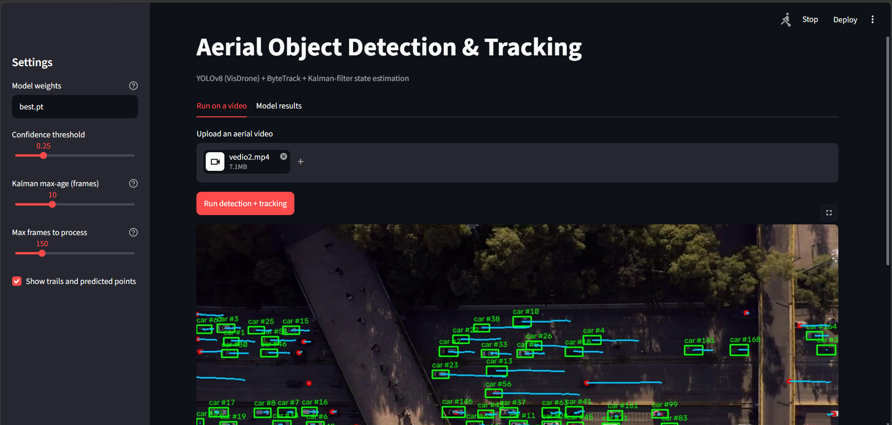
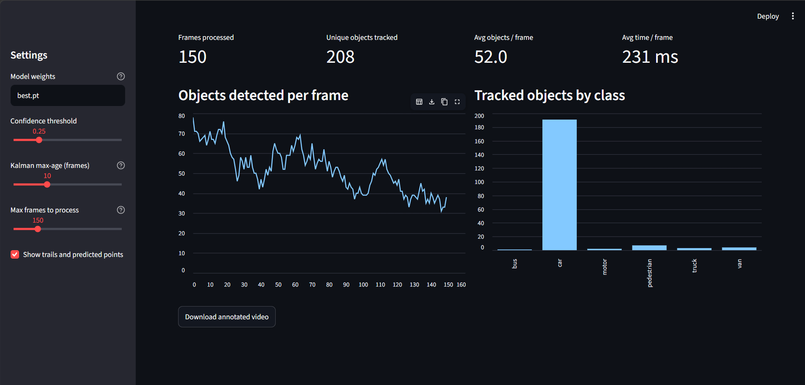
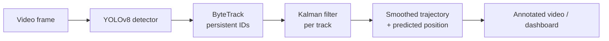

<h1 align="center">Aerial Object Detection & Tracking</h1>

<p align="center">
  YOLOv8 detection on aerial imagery (VisDrone) &middot; ByteTrack multi-object tracking &middot;
  custom Kalman-filter state estimation &middot; ONNX export &middot; Streamlit dashboard
</p>

<p align="center">
  
  
  
  
  
</p>

<p align="center">
  
</p>

<p align="center"><i>Output of the full pipeline on aerial traffic footage: green boxes are detections with track IDs,
blue lines are Kalman-smoothed trajectories, red dots are positions predicted by the filter when the detector missed an object.</i></p>

## Overview

An end-to-end computer vision pipeline for aerial video. A YOLOv8 detector is fine-tuned on the
[VisDrone](https://github.com/VisDrone/VisDrone-Dataset) dataset, ByteTrack assigns persistent IDs to objects across frames,
and a custom constant-velocity **Kalman filter** smooths each track and keeps predicting an object's position
when the detector misses it. The trained model is exported to **ONNX** and benchmarked against PyTorch, and a
**Streamlit dashboard** lets you run the whole pipeline on any uploaded video.

## Before vs. after fine-tuning

The pretrained COCO model was trained on ground-level photos, so it misses most vehicles in a top-down view.
Fine-tuning on VisDrone fixes this.

| Pretrained YOLOv8n (COCO) | Fine-tuned on VisDrone |
|:---:|:---:|
|  |  |
| Detects only a handful of the cars | Detects most vehicles across all lanes |

## Results

**Detection accuracy** (VisDrone validation set, YOLOv8n fine-tuned)

| Metric | Value |
|---|---|
| mAP50 | **28.9%** |
| mAP50-95 | **16.1%** |

**Inference speed** (Intel Core i3-1125G4 CPU, end-to-end per frame, averaged over 100 frames)

| Model | ms / frame |
|---|---|
| PyTorch (`.pt`) | 319.8 |
| ONNX Runtime (`.onnx`) | **202.9** (~37% faster) |

VisDrone is a hard benchmark: objects are tiny, crowded and often in shadow, so absolute mAP values are modest,
especially for the smallest (nano) model after a short training run.

## Dashboard

Upload an aerial video, adjust the confidence threshold, Kalman max-age and number of frames, and watch detection and
tracking run live. When processing finishes, the dashboard summarises the run and lets you download the annotated video.

<p align="center">
  
</p>

**Example run** (150 frames of aerial traffic footage, CPU):

| Frames processed | Unique objects tracked | Avg objects / frame | Avg time / frame |
|:---:|:---:|:---:|:---:|
| 150 | 208 | 52.0 | 231 ms |

The class breakdown shows mostly cars, plus buses, motorbikes, pedestrians, trucks and vans.

<p align="center">
  
</p>

```bash
streamlit run app.py
```

## How it works



1. **Detection:** YOLOv8 outputs bounding boxes, classes and confidences for the 10 VisDrone classes.
2. **Tracking:** ByteTrack matches boxes between frames so each object keeps one ID.
3. **State estimation:** each track's centre is modelled with a constant-velocity state `[x, y, vx, vy]`.
   - *Predict:* move the state forward with the motion model, `x = F x`, `P = F P Fᵀ + Q`.
   - *Update:* correct it with the detector's measurement, `K = P Hᵀ (H P Hᵀ + R)⁻¹`.
   - When the detector misses an object, only the predict step runs for up to `--max-age` frames (red dots).

## Project structure

```
aerial-object-detection-tracking/
├── app.py              # Streamlit dashboard
├── detect_track.py     # detection + tracking + Kalman filter on a video
├── kalman.py           # constant-velocity Kalman filter (NumPy)
├── train.py            # fine-tune YOLOv8 on VisDrone (run on a GPU)
├── export_onnx.py      # export trained weights to ONNX
├── benchmark.py        # PyTorch vs ONNX Runtime speed comparison
├── requirements.txt
└── results/            # screenshots used in this README
```

## Getting started

```bash
git clone https://github.com/PaulamiS/aerial-object-detection-tracking.git
cd aerial-object-detection-tracking
python -m venv venv
venv\Scripts\activate          # Windows  (Mac/Linux: source venv/bin/activate)
pip install -r requirements.txt
```

Model weights and videos are not stored in the repo. Train your own `best.pt` (below) and place it in the project folder.

### Train (use a GPU, e.g. free Google Colab)
```bash
python train.py        # downloads VisDrone automatically, fine-tunes YOLOv8n at 640 px
```

### Run detection + tracking on a video
```bash
python detect_track.py --source video.mp4 --model best.pt --out results/output.mp4
```

### Export to ONNX and benchmark
```bash
python export_onnx.py best.pt
python benchmark.py best.pt best.onnx video.mp4
```

### Launch the dashboard
```bash
streamlit run app.py
```

## Known limitations

- Small, fast, crowded objects cause some missed detections, especially dark vehicles in shadow.
- Tracking can switch IDs when an object is lost for several frames in dense traffic.
- Trained for a short run on the nano model; a larger model or more epochs would raise mAP.
- Speed numbers are CPU-only. GPU inference would be much faster.

## Future work

- Train a larger model (YOLOv8s/m) for longer and compare accuracy.
- Add TensorRT export for GPU / Jetson deployment.
- Wrap the pipeline in a ROS 2 node for robotics integration.
- Replace the constant-velocity model with an Extended Kalman Filter for manoeuvring objects.

## Tech stack

Python, PyTorch, Ultralytics YOLOv8, OpenCV, NumPy, ONNX, ONNX Runtime, Streamlit, Pandas

## Author

**Paulami Sahu**, B.Tech CSE, VIT &middot; [GitHub](https://github.com/PaulamiS)